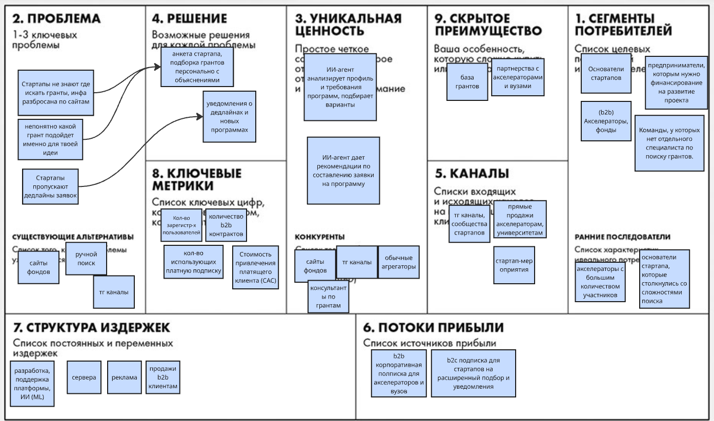

# ДЗ №1: Elevator Pitch, Lean Canvas

## Проект: Агрегатор грантов для стартапов

### Elevator Pitch

Многие стартапы теряют возможность получить финансирование, потому что информация о грантах и программах поддержки разбросана по множеству сайтов, а поиск подходящих условий отнимает много времени. Мы предлагаем платформу, которая собирает информацию о грантах и программах поддержки в одном месте и подбирает подходящие возможности с учётом стадии развития, отрасли и региона стартапа. Пользователи смогут быстро оценивать условия участия, отслеживать дедлайны и переходить к официальным источникам для подачи заявок. Для акселераторов и фондов платформа станет каналом привлечения подходящих стартапов и продвижения их программ поддержки. В результате стартапы экономят время и получают больше шансов найти финансирование, а организаторы программ — участников.

### Lean Canvas

# ДЗ №2

## 1. HADI-гипотеза

**Самый критичный риск из Lean Canvas (для b2b):** Риск ценности — будут ли фонды и акселераторы платить деньги за размещение их программ 

- **H:** Акселераторы грантов и фонды готовы платить деньги за размещение своих программ на нашей платформе,потому что им нужны заявки от стартапов. 
- **A:** Создать тг-канал, набрать n подписчиков через рекламу, написать 20 акселераторам "у нас канал на n основателей стартапов, хотели бы разместить программы? выставить счет/просить предоплату.
- **D:** Сколько акселераторов реально оплатили
- **I:** 3+ из 20 оплатили - b2b работает

**Самый критичный риск из Lean Canvas (для b2c):** Риск ценности — будут ли основатели стартапов платить деньги за подписку (расширенный каталог программ, персональная подборка, уведомления о дедлайнах), если есть тг-каналы акселераторов.

- **H:** Стартапы устали искать гранты на разных сайтах, находят много программ которые им не подходят. Основатели стартапов готовы платить подписку на сервис, который предлагает персональную подборку подходящих грантов и присылает уведомления о дедлайнах.
- **A:** Сделать одностраничный лендинг с описанием сервиса и кнопкой "оформить полписку". запустить рекламу
- **D:** Замерить CPC (стоимость клика) и конверсию в нажатие кнопки
- **I:** Если CPC ниже 150 руб, а конверсия выше 5% — гипотеза подтверждена

## 2. Расчёт юнит-экономики

**b2c модель:**

- **Стоимость клика в рекламе:** 100 руб.
- **Конверсия в регистрацию:** 25%. Стоимость одной бесплатной регистрации: 100 руб. / 0,25 = 400 руб.
- **Конверсия в покупку платной подписки:** 10%
- **CAC** = 4000 руб.

- **LTV**
- **Стоимость подписки** 1500руб/мес
- **Сервера** 100рублей/мес
- **Прибыль сс одного клиента** 1400руб/мес
- **Средний срок жихни клиента** 9 мес
- **LTV** = 1400*9=12600

- **LTV/CAC** = 3,15

**b2b модель**
Предположим, за месяц мы потратили на привлечение 50000 руб. (100 контактов по 500 руб.). 15% компаний перешли к переговорам, конверсия в договор 10%. 
- **CAC**
- **Стоимость контакста с организацией 500 руб(письма, прямые продажи)
- **Конверсия в переговоры** 15%, стоимость переговоров 3333руб.
- **конверсия в договор** 10%
- **CAC** = 3333/0.1 = 33333

- **LTV**
- **Цена размещения** 10000руб/мес
- **Затраты** 1000руб/мес
- **Прибыль с одного акселератора** 9000руб/мес
- **Средний срок жизни клиента** 12 мес
- **LTV** = 9000*12=108000руб

- **LTV/CAC** = 108000/3333=3,24

Показатель больше 3, а значит юнит-экономика сходится.

## 3. Pivot

Technology Pivot - Можно изменить технологию подбора финансирования для стартапов, внедврив ИИ, который будет анализировать описание стартапа и требования грантов, учитывать контекст проекта и формировать персонализированные рекомендации с объяснением причин выбора. 
Т.е.мы переходим от подбора по формальным параметрам к интеллектуальному анализу и сопоставлению данных с помощью ИИ.

### Elevator Pitch
Стартапам сложно находить подходящие гранты, поскольку информация о финансировании разбросана по разным источникам, а требования программ могут быть сложными и отличаться друг от друга. Мы создаём ИИ-агента для поиска грантов, который анализирует профиль стартапа, сопоставляет его с требованиями программ финансирования и предлагает персонализированную подборку с объяснением, почему каждый грант подходит проекту. Мы помогаем стартапам экономить время на поиске финансирования, а акселераторам и университетам — находить подходящие программы для своих участников.

### Lean Canvas

# ДЗ №3

Будем дальше работать с изначальной идей проекта, до пивота, так как юнит-экономика сошлась.
## 1. Роли и User Stories
**Роли:**
- Основатель стартапа (b2c) - ищет гранты и программы поддержки для запуска и развития своего проекта
- Организатор грантовых программ (b2b) - размещает инфу о грантах, обновляет данные
- Консультант по грантам/акселератор - ищет программы для своих клиентов/участников

**User stories:**
1. Как любой пользователь, я хочу зарегистрироваться на платформе, чтобы сохранить свои данные.
2. Как основатель стартапа, я хочу указать стадию развития своего проекта, чтобы видеть программы, подходящие моему этапу.
3. Как основатель стартапа, я хочу указать отрасль своего проекта, чтобы получать гранты, соответствующие сфере деятельности.
4. Как основатель стартапа, я хочу указать  регион, чтобы видеть программы, в которых мой проект имеет право участвовать.
5. Как основатель стартапа, я хочу указать потребность в финансировании, чтобы находить гранты с подходящим размером поддержки.
6. Как основатель стартапа, я хочу просматривать каталог грантов и программ поддержки, чтобы изучать доступные возможности финансирования.
7. Как основатель стартапа, я хочу получать персональную подборку программ на основе параметров моего проекта, чтобы тратить меньше времени на поиск.
8. Как основатель стартапа, я хочу видеть требования к участникам каждой программы, чтобы заранее понимать, подходит ли мне грант
9. Как основатель стартапа, я хочу видеть сумму финансирования, сроки и дедлайн подачи заявки, чтобы оценивать привлекательность программы.
10. Как основатель стартапа, я хочу переходить к официальному источнику программы, чтобы проверять условия и подавать заявку.
11. Как основатель стартапа, я хочу сохранять интересующие меня программы в избранное, чтобы вернуться к ним позже.
12. Как основатель стартапа, я хочу получать напоминания о приближении дедлайна, чтобы не пропустить срок подачи заявки.
13. Как основатель стартапа, я хочу получать уведомления о новых подходящих грантах, чтобы узнавать о возможностях финансирования вовремя.
14. Как основатель стартапа, я хочу видеть объяснение, почему конкретная программа мне подходит, чтобы понимать релевантность рекомендации. 
15. Как организатор, я хочу отправить информацию о своей программе на размещение, чтобы привлечь подходящие стартапы.
16. Как организатор, я хочу обновлять условия и сроки программы, чтобы потенциальные участники видели актуальную информацию.
17. Как организатор, я хочу получать статистику просмотров и переходов по своей программе, чтобы оценивать эффективность размещения.
18. Как консультант по грантовым программам, я хочу искать гранты по параметрам проектов моих клиентов, чтобы находить подходящие варианты.
19. Как консультант по грантовым программам, я хочу делится ссылками на найденные гранты, чтобы мои клиенты изучили возможность финансирования.

## 2. Приоритизация по методу MoSCoW
**M (Must have):**
- выбор стадии стартапа
- выбор отрасли
- выбор региона
- каталог программ
- персональная подборка
- просмотр требований к участникам
- сумма, сроки и дедлайн
- отправка программы финансирования на размещение

**S (Should have):**
- регистрация пользователя
- указание потребности в финансирование
- ссылка на оффициальный источник
- напоминания о дедлайнах
- поиск по программ по фильтрам

**С (Could Have):**
- добавление программы в избранное
- уведомление о новых программах
- объяснение подбора рекомендованных программ
- обновление условий программы
- ссылки на найденные гранты

**W (Won't have now):**
- статистика просмотров и переходов по программе

## 3. MVP и MLP
**MVP** - минимально жизнеспособный продукт
- каталог грантов
- форма параметров стартапа (отрасль, стадия, регион)
- подбор подходящих программ
- карточка программы (условия, дедлайн, ифна...)
- для организаторов отправка информации о гранте

**MLP** - продукт с дополнительной ценностью
- персональные уведомления о новых грантах
- сохранение профиля
- напоминания о дедлайнах
- ссылка на оффициальный источник
- избранное
- объяснение почему грант подходит
- обновление программ

## 4. Детализация требований из MVP
Story 1: Как основатель стартапа, я хочу получать персональную подборку программ на основе параметров моего проекта, чтобы тратить меньше времени на поиск.

Функциональные требования:
- Система должна предоставлять пользователю форму указания параметров стартапа: стадия развития, отрасль и страна или регион.
- Система должна сохранять введённые параметры на время формирования подборки.
- Для каждой программы должны отображаться название, организатор, краткое описание и срок подачи заявки, если он известен.
- Система должна отбирать программы, соответствующие указанным параметрам.
- Система должна сообщать пользователю, если подходящие программы не найдены, и предлагать изменить параметры поиска.

Нефункциональные требования:
- При работе с каталогом MVP подборка должна отображаться не позднее чем через 3 секунды при штатной нагрузке.
- Пользователь должен иметь возможность заполнить форму без специальных технических знаний.
- Интерфейс должен корректно отображаться на мобильных устройствах и компьютерах.
- Система не должна показывать программу как подходящую, если в базе указано несоответствие обязательным критериям участия.

Story 2: Как основатель стартапа, я хочу видеть карточку программы, чтобы заранее понимать, подходит ли мне грант и стоит ли тратить время на подготовку заявки.

Функциональные требования:
- Карточка должна содержать название гранта и название организации-организатора.
- Карточка должна отображать описание программы и критерии участия, если эти данные предоставлены.
- Карточка должна содержать сведения о размере финансирования, географических ограничениях и сроках подачи заявок, если они известны.
- Если информация отсутствует, система должна показывать «Не указано»
- Если срок подачи заявки завершён, система должна показывать статус «Приём заявок завершён».

Нефункциональные требования:
- Карточка должна загружаться не более чем за 2 секунды в 95% запросов при штатной нагрузке.
- Карточка должна корректно отображаться на мобильных устройствах и компьютерах.
- После подтверждения изменений условий организатором информация должна обновляться не позднее одного рабочего дня.

