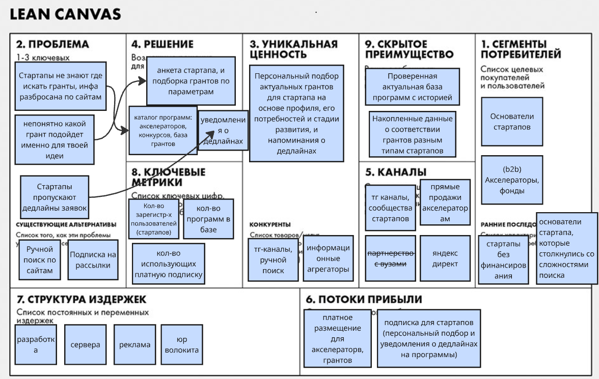

# ДЗ №1: Elevator Pitch, Lean Canvas

## Проект: Агрегатор грантов для стартапов

### Elevator Pitch

Многие стартапы теряют возможность получить финансирование, потому что информация о грантах и программах поддержки разбросана по множеству сайтов, а поиск подходящих условий отнимает много времени. Мы предлагаем платформу, которая собирает информацию о грантах и программах поддержки в одном месте и подбирает подходящие возможности с учётом стадии развития, отрасли и региона стартапа. Пользователи смогут быстро оценивать условия участия, отслеживать дедлайны и переходить к официальным источникам для подачи заявок. Для акселераторов и фондов платформа станет каналом привлечения подходящих стартапов и продвижения их программ поддержки. В результате стартапы экономят время и получают больше шансов найти финансирование, а организаторы программ — участников.

### Lean Canvas

